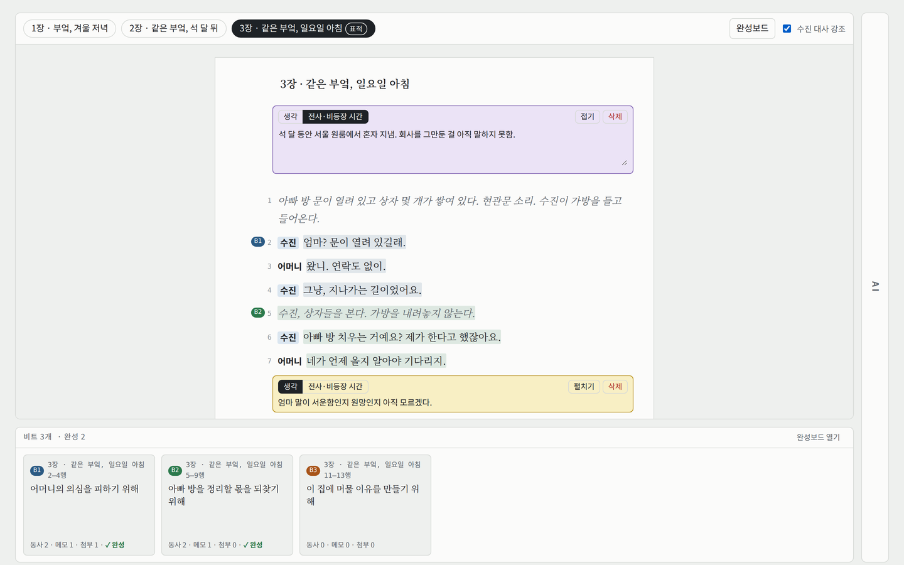
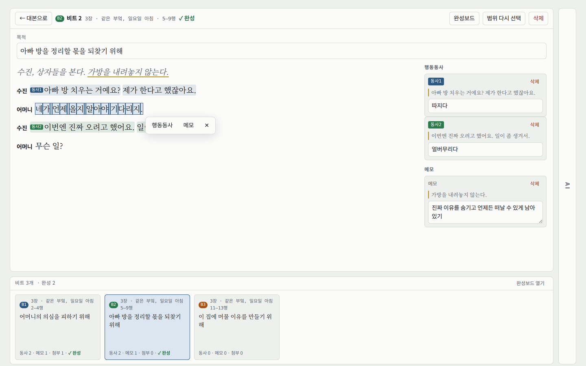
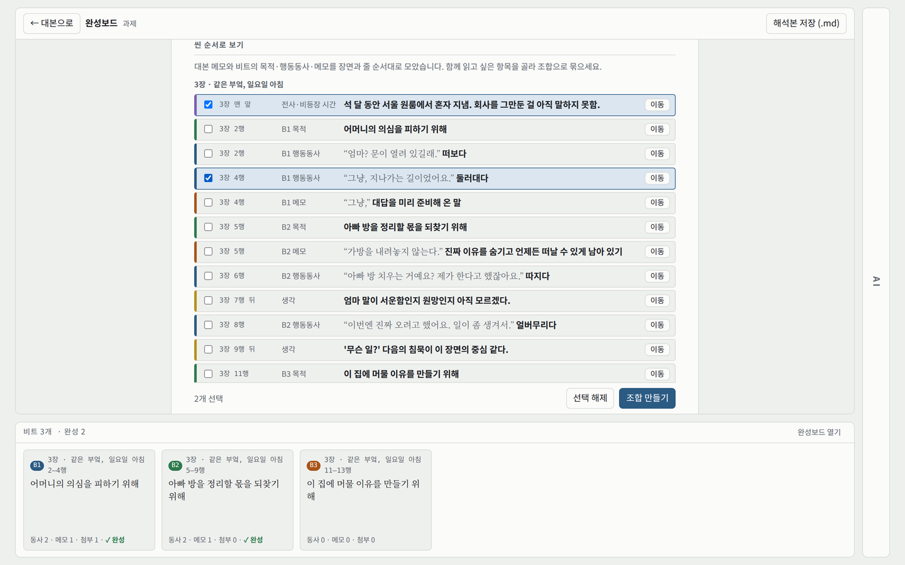
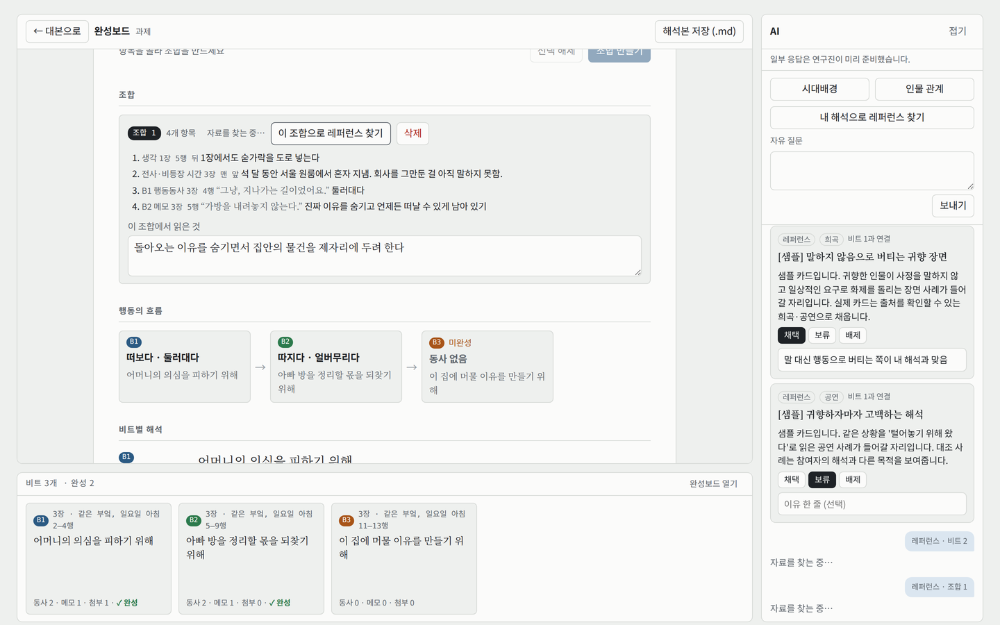
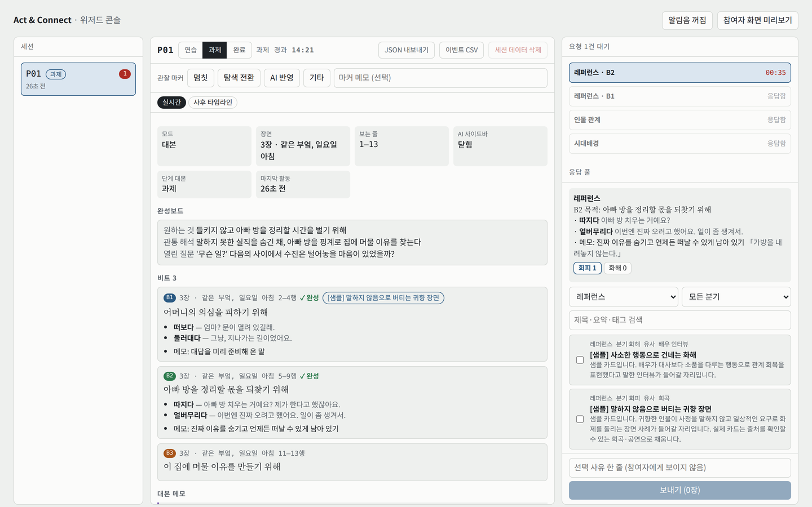

# Act & Connect — Phase 1 프로토타입

드라마투르기 기반 AI 인터랙티브 시스템을 활용한 **배우의 캐릭터 해석 지원 연구**(이화여자대학교)의 Phase 1 형성 연구용 프로토타입입니다. 배우가 대본에 메모하고, 그 메모를 구조화하고, 구조화한 해석을 근거로 레퍼런스를 얻는 과정에서 AI를 언제·어떻게 찾는지 관찰하기 위해 만들었습니다.

**▶ 데모:** [`demo/`](demo/) — GitHub Pages를 켜면 `https://vivi827.github.io/Dramaturg_AI/phase1/demo/`에서 바로 써 볼 수 있습니다. 데모는 claude.ai 없이 브라우저 안에서만 동작하며, 데이터는 그 브라우저에만 저장됩니다. 탭 두 개(참여자 화면 / `?role=wizard` 연구자 콘솔)를 열면 Wizard-of-Oz 흐름을 함께 체험할 수 있습니다.



## Phase 1 최소 기능

| 단계 | 기능 | 화면 |
| --- | --- | --- |
| ① 극에 메모 | 대본 줄 사이 메모(생각·전사), 비트 나누기(1초 누르기 → 클릭), 비트별 목적·행동동사·메모 | 대본 뷰어, 비트 상세 |
| ② 메모 구조화 | 모든 메모를 장면·줄 순서로 한 목록에 모아 보고, 함께 읽을 항목을 골라 **조합**으로 묶고 한 줄 해석 달기 | 완성보드 · 씬 순서로 보기 / 조합 |
| ③ 레퍼런스 얻기 | 조합(또는 완성된 비트)을 근거로 레퍼런스 요청 → 연구자가 미리 검증한 카드를 골라 응답(Wizard-of-Oz) → 채택·보류·배제 | AI 사이드바, 위저드 콘솔 |

| 비트 상세 | 완성보드 · 씬 순서로 보기 |
| --- | --- |
|  |  |
| **완성보드 · 조합과 조합 레퍼런스** | **위저드 콘솔** |
|  |  |

## 화면 구성

| 화면 | 역할 |
| --- | --- |
| 대본 뷰어 (위 75%) | 장면별 대본, 비트 범위 표시, 줄 사이 대본 메모 |
| 비트 메뉴 (아래 25%) | 만든 비트 카드 목록과 완성 여부, [완성보드 열기] |
| 비트 상세 | 목적, 문장 드래그로 행동동사 나누기와 메모 |
| 완성보드 | 씬 순서로 보기, 조합 만들기·조합 레퍼런스 요청, 캐릭터 해석본, .md 저장 |
| AI 사이드바 (오른쪽 세로) | 시대배경·인물 관계·자유 질문·레퍼런스 요청, 카드 채택/보류/배제 |
| 위저드 콘솔 (게시자 전용) | 실시간 미러, 요청 큐(대기 시간), 응답 풀·분기 후보, 관찰 마커, 사후 타임라인, 내보내기 |

## 두 가지 실행 방식

| | 연구 세션용 (claude.ai Artifact) | 데모 (`demo/index.html`) |
| --- | --- | --- |
| 실행 위치 | claude.ai에 게시한 Artifact | GitHub Pages 또는 로컬 브라우저 |
| 데이터 | Artifact `db` (서버, 참여자별 접근 규칙) | 브라우저 localStorage (이 기기에만) |
| 참여자·연구자 구분 | 초대받은 계정 / 게시자 계정 | URL (`?role=wizard`) |
| 용도 | 실제 Phase 1 세션 | 포트폴리오 공유, 사용성 시연, 조작 연습 |

`src/act-connect.html`은 claude.ai Artifact의 runtime capabilities(`db`, `user`, `downloads`)에 의존하므로 그대로 열면 "초대받은 계정으로 로그인한 뒤 다시 열어 주세요"만 표시됩니다. `demo/index.html`은 같은 소스에 브라우저용 대체 런타임과 샘플 데이터를 붙인 것으로, `demo/build_demo.py`로 다시 만들 수 있습니다.

### 데모를 GitHub Pages로 공개하기

1. 저장소 **Settings → Pages**에서 Source를 *Deploy from a branch*, Branch를 `main` / `(root)`로 저장합니다.
2. 1~2분 뒤 `https://vivi827.github.io/Dramaturg_AI/phase1/demo/`가 열립니다.
3. 소스를 고친 뒤에는 `phase1/` 폴더에서 `python3 demo/build_demo.py .`로 데모를 다시 만들어 함께 커밋합니다.

버전별 변경은 [CHANGELOG.md](CHANGELOG.md)에 적습니다.

## 구성

| 경로 | 내용 |
| --- | --- |
| `src/act-connect.html` | 게시된 Artifact 소스(HTML·CSS·JS 단일 파일). 게시 시 문서 골격이 자동으로 덧붙으므로 `<html>`·`<body>` 태그가 없습니다 |
| `demo/index.html` | 브라우저 데모(대체 런타임 + 샘플 데이터 포함). `demo/build_demo.py`로 생성 |
| `docs/images/` | README 화면 캡처(샘플 데이터) |
| `data/capabilities.json` | 게시할 때 선언하는 capabilities와 db 접근 규칙 |
| `data/sample-config.json` | `config/script`, `config/practice`, `config/settings` 샘플(지어낸 장면) |
| `data/sample-pool.json` | `pool/*` 응답 카드 샘플(모두 [샘플] 표시, 출처 없음) |
| `CHANGELOG.md` | 버전별 변경 기록 |
| `docs/MANUAL.md` | 참여자 초대, 세션 진행, AI 사이드바 운영, 데이터 처리 매뉴얼 |

## 다시 게시하기

1. Claude(Artifact 게시 기능이 있는 대화)에 `src/act-connect.html`을 주고, `data/capabilities.json`의 capabilities로 게시해 달라고 요청합니다.
2. 게시 후 `data/sample-config.json`과 `data/sample-pool.json` 형식대로 실제 대본과 응답 풀을 데이터베이스에 넣어 달라고 요청합니다.
3. 게시한 계정이 위저드 콘솔의 소유자가 됩니다.

## 데이터 구조 (Artifact db)

```
config/script | practice | settings     모두 읽기, 소유자만 쓰기
pool/{cardId}                           소유자만
wizardlog/{id}                          소유자만 (선택 사유, 관찰 마커, 단계 변경)
sessions/{uid}                          {activeCode}
sessions/{uid}/runs/{code}              {phase, taskStartAt, uiMode, openBeatId, sceneId, viewport, ...}
  .../beats/{id}      {mode, sceneId, range{start,end}, purpose, verbs[{id,keys[],verb}], memos[{id,start,end,text}], attachedCards[]}
  .../notes/{id}      {mode, sceneId, afterLine, kind: think|past, text, collapsed}
  .../requests/{id}   {type: background|relation|free|reference, text, beatId, beatSnapshot, bundleId, bundleSnapshot, status}
  .../responses/{id}  {requestId, beatId, cards[], sentAt, origin, waitMs}
  .../decisions/{id}  {requestId, cardId, beatId, decision: accept|hold|reject, reason}
  .../board/{practice|task}  {superObjective, throughline, openQuestions, updatedAt}
  .../bundles/{id}    {mode, items["note:id"|"beat:id"|"verb:beat:group"|"memo:beat:memo"], note, attachedCards[]}
  .../events/{id}     {seq, events[{t, type, target, data}]}   10초 또는 25개 단위 묶음
```

참여자(편집자로 초대)는 `config`와 자기 `sessions/{uid}` 아래만 읽고 씁니다. 응답 풀과 위저드 기록은 볼 수 없습니다. 한 계정을 여러 참여자가 쓰는 경우를 위해 기록은 참여자 코드(`runs/{code}`)별로 나뉩니다.

## 이벤트 유형

입장·단계 `session_join`, `task_start` · 화면 `mode_switch`, `scene_open`, `viewport` · 비트 만들기 `beat_start_set`, `beat_end_set`, `beat_select_cancel`, `beat_overlap_rejected`, `beat_create`, `beat_range_change`, `beat_delete`, `beat_open` · 비트 편집 `beat_edit`, `verb_assign`, `verb_edit`, `verb_remove`, `beat_memo_create|edit|delete` · 대본 메모 `note_create|edit|toggle|delete` · AI `ai_panel_open`, `ai_panel_close`, `ai_request`, `ai_response_shown`, `ref_link_open`, `ref_decision` · 완성보드 `board_edit`(필드별 before/after), `board_export` · 조합 `bundle_pick`, `bundle_create`, `bundle_edit`, `bundle_delete`

## 연구 데이터 관련

- 참여자 기록(내보낸 JSON·CSV, 녹화, 전사)은 **이 저장소에 커밋하지 않습니다.** IRB 계획서에 따라 연구책임자의 암호화된 컴퓨터에만 보관합니다.
- 실제 대본은 저작권(번역본 포함)을 확인한 뒤에만 커밋합니다.
