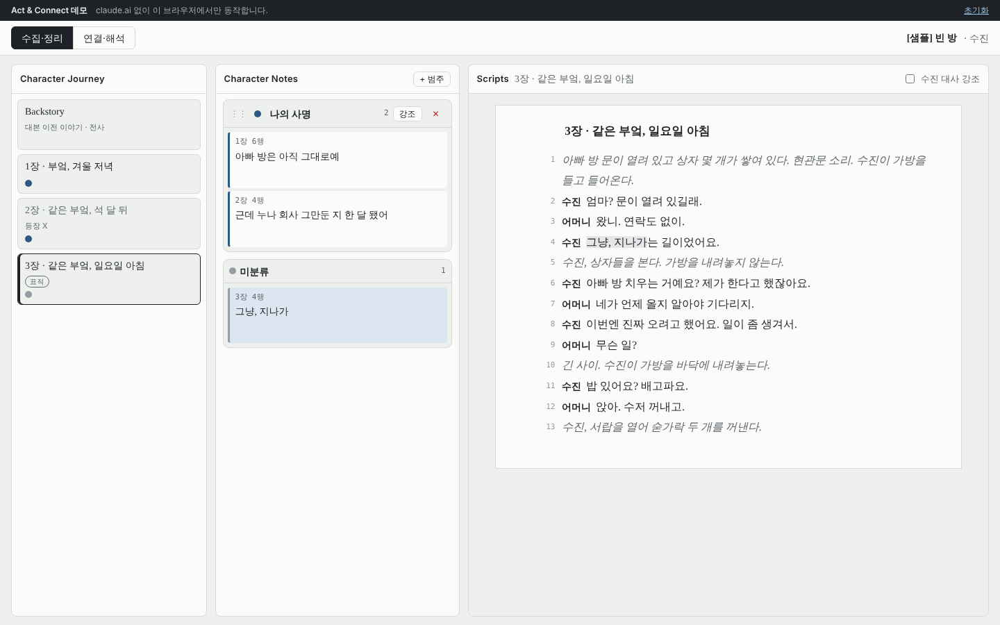
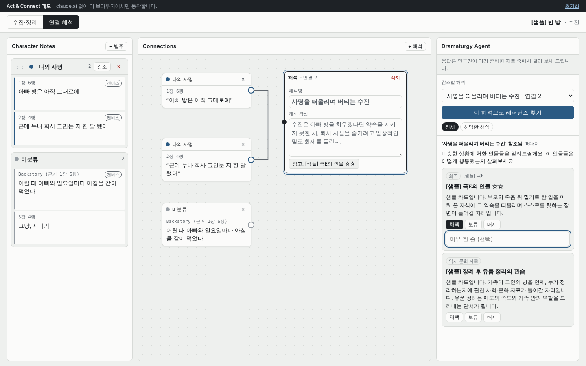
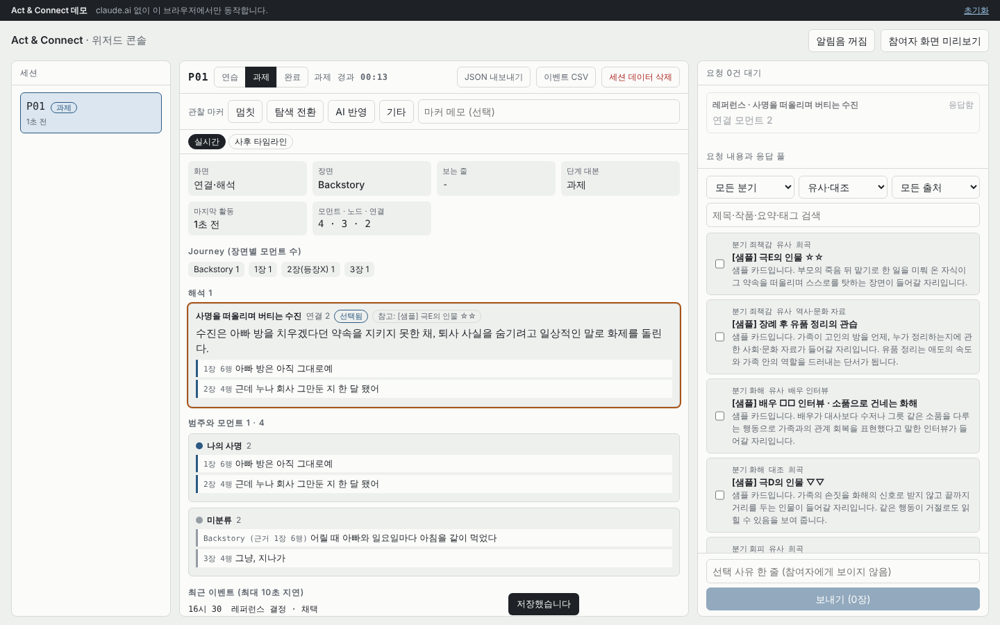

# Act & Connect — Phase 1 프로토타입

드라마투르기 기반 AI 인터랙티브 시스템을 활용한 **배우의 캐릭터 해석 지원 연구**(이화여자대학교)의 Phase 1 형성 연구용 프로토타입입니다. 구현 기준은 [SPEC.md](SPEC.md)(v2, 연구계획서 ver1.1과 기획안 0811에 맞춘 명세)입니다.

- **RQ1.** 분산된 캐릭터 정보를 하나의 서사적 흐름 안에서 연결하는 상호작용은 배우의 캐릭터 해석을 어떻게 지원하는가?
- **RQ2.** AI가 배우의 캐릭터 해석을 기반으로 제공하는 드라마투르기적 레퍼런스는 기존 해석을 확장하고 새로운 연기 가능성을 탐색하는 데 어떻게 활용되는가?

원칙: **AI는 정보를 분류하거나 해석하지 않습니다.** 참여자가 대본에서 직접 고르고 구조화한 정보를 시스템이 시각화하고, 레퍼런스는 참여자가 구성한 해석을 맥락으로만 제안합니다. 레퍼런스 응답은 실제 LLM이 아니라 연구자가 미리 검증한 카드를 골라 보내는 Wizard-of-Oz 방식입니다.

**▶ 데모:** [`demo/`](demo/) — GitHub Pages를 켜면 `https://vivi827.github.io/Dramaturg_AI/phase1/demo/`에서 바로 써 볼 수 있습니다. 데모는 claude.ai 없이 브라우저 안에서만 동작하며, 데이터는 그 브라우저에만 저장됩니다. 처음 열면 "참여자이신가요, 연구자이신가요?" 화면이 뜹니다. 연구자를 고르면 PIN(`build_demo.py`의 `WIZARD_PIN`, 기본값 `0827`)을 입력해야 콘솔이 열립니다. 클라이언트 전용 데모라 PIN은 소스에 그대로 들어 있어 실수로 들어가는 것만 막아 줄 뿐, 보안 장치는 아닙니다. 참여자 탭과 연구자 탭을 같은 브라우저에 나란히 열면 요청과 응답이 서로 반영됩니다.

## 화면

| 화면 1 · 수집·정리 | 화면 2 · 연결·해석 |
| --- | --- |
|  |  |

| 영역 | 기획안 대응 | 하는 일 |
| --- | --- | --- |
| **Character Journey** | 와이어프레임 (1) | Backstory와 장면 목록. 장면마다 범주 색 점, 표적 인물 등장 여부. 누르면 Scripts가 그 장면으로 이동 |
| **Character Notes** | 와이어프레임 (1)·(2) | 참여자가 직접 만든 범주(이름·색·순서)에 모먼트를 정리. 끌어서 범주 이동, 메모 한 줄, [강조]로 한 범주만 보기 |
| **Scripts** | 와이어프레임 (1) | 모든 장면에서 문구를 드래그 → [모먼트로 저장] → 범주 선택(또는 새 범주). 범주 색 하이라이트. Backstory 칸에서는 대본 밖 정보를 자유 기술 모먼트로 추가 |
| **Connections** | 와이어프레임 (2) | 모먼트를 캔버스로 끌어 노드로 만들고, [+ 해석]으로 해석 노드(해석명·해석 작성)를 만든 뒤 모먼트 오른쪽 점을 해석 노드로 끌어 연결 |
| **Dramaturgy Agent** | 와이어프레임 (2) | 연결 모먼트 2개 이상 + 해석 작성이 있는 해석으로 레퍼런스 요청 → "'해석명' 참조됨"과 카드 → 채택·보류·배제와 이유. 채택하면 해석 노드에 "참고: …" 칩 |
| 위저드 콘솔 | — | 실시간 미러(화면·장면·범주·모먼트·해석), 요청 큐와 해석 스냅샷, 분기 후보, 응답 풀, 관찰 마커, 사후 타임라인, JSON·CSV 내보내기, 세션 삭제 |



## 두 가지 실행 방식

| | 연구 세션용 (claude.ai Artifact) | 데모 (`demo/index.html`) |
| --- | --- | --- |
| 실행 위치 | claude.ai에 게시한 Artifact | GitHub Pages 또는 로컬 브라우저 |
| 데이터 | Artifact `db` (서버, 참여자별 접근 규칙) | 브라우저 localStorage (이 기기에만) |
| 참여자·연구자 구분 | 초대받은 연구용 계정 / 게시자 계정 | 첫 화면에서 선택(연구자는 PIN) |
| 용도 | 실제 Phase 1 세션 | 시연, 조작 연습, 파일럿 |

`src/act-connect.html`은 claude.ai Artifact의 runtime capabilities(`db`, `user`, `downloads`)에 의존하므로 그대로 열면 "초대받은 계정으로 로그인한 뒤 다시 열어 주세요"만 표시됩니다. `demo/index.html`은 같은 소스에 브라우저용 대체 런타임과 샘플 데이터를 붙인 것으로, `phase1/` 폴더에서 `python3 demo/build_demo.py .`로 다시 만듭니다. 소스를 고치면 데모도 다시 만들어 함께 커밋합니다.

### 데모를 GitHub Pages로 공개하기

1. 저장소 **Settings → Pages**에서 Source를 *Deploy from a branch*, Branch를 `main` / `(root)`로 저장합니다.
2. 1~2분 뒤 `https://vivi827.github.io/Dramaturg_AI/phase1/demo/`가 열립니다.

버전별 변경은 [CHANGELOG.md](CHANGELOG.md)에 적습니다.

## 구성

| 경로 | 내용 |
| --- | --- |
| `SPEC.md` | 설계 명세 v2 (구현 기준) |
| `src/act-connect.html` | 게시된 Artifact 소스(HTML·CSS·JS 단일 파일). 게시 시 문서 골격이 자동으로 덧붙으므로 `<html>`·`<body>` 태그가 없습니다 |
| `demo/index.html` | 브라우저 데모(대체 런타임 + 샘플 데이터 포함). `demo/build_demo.py`로 생성 |
| `docs/images/` | README 화면 캡처(샘플 데이터) |
| `data/capabilities.json` | 게시할 때 선언하는 capabilities와 db 접근 규칙 |
| `data/sample-config.json` | `config/script`, `config/practice`, `config/settings` 샘플(지어낸 장면) |
| `data/sample-pool.json` | `pool/*` 레퍼런스 카드 샘플(모두 [샘플] 표시, 출처 없음) |
| `docs/MANUAL.md` | 연구 세션 운영 매뉴얼 |
| `CHANGELOG.md` | 버전별 변경 기록 |

## 다시 게시하기

1. Claude(Artifact 게시 기능이 있는 대화)에 `src/act-connect.html`을 주고, `data/capabilities.json`의 capabilities로 게시해 달라고 요청합니다.
2. 게시 후 `data/sample-config.json`과 `data/sample-pool.json` 형식대로 실제 대본과 응답 풀을 데이터베이스에 넣어 달라고 요청합니다.
3. 게시한 계정이 위저드 콘솔의 소유자가 됩니다.

## 데이터 구조 (Artifact db)

```
config/script | practice | settings         모두 읽기, 소유자만 쓰기
pool/{cardId}                               소유자만  {type: reference|fallback, title, play, character, sourceType, branch, polarity, summary, quote, sourceUrl, keywords[], tags[]}
wizardlog/{id}                              소유자만  {runKey, t, kind: marker|choice|phase, label, note}
sessions/{uid}                              {activeCode}
sessions/{uid}/runs/{code}                  {phase, taskStartAt, ui{screen, sceneId, highlight, focusCategoryId, selectedInterpId, canvasScroll, viewport}, lastActiveAt}
  .../categories/{id}   {mode, name, color, order}
  .../moments/{id}      {mode, source: script|backstory, sceneId, range, quote, text, categoryId, memo, evidence}
  .../nodes/{momentId}  {mode, x, y}
  .../interps/{id}      {mode, name, body, x, y, attachedCards[]}
  .../links/{id}        {mode, momentId, interpId}
  .../requests/{id}     {mode, interpId, snapshot{name, body, label, moments[]}, status}
  .../responses/{id}    {requestId, interpId, cards[], sentAt, waitMs}
  .../decisions/{id}    {requestId, cardId, interpId, decision: accept|hold|reject, reason, t}
  .../events/{id}       {seq, events[{t, type, target, data}]}   10초 또는 25개 단위 묶음
```

참여자(연구용 계정)는 `config`와 자기 `sessions/{uid}` 아래만 읽고 씁니다. 응답 풀과 위저드 기록은 볼 수 없습니다. 한 계정을 여러 참여자가 쓰므로 기록은 참여자 코드(`runs/{code}`)별로 나뉩니다. `mode`는 `practice` | `task`입니다.

## 이벤트 유형 (연구계획서 수집 항목 대응)

| 수집 항목 | 이벤트 |
| --- | --- |
| 공통 | `session_join`, `task_start`, `screen_switch`, `scene_open`, `backstory_open`, `viewport`, `category_focus` |
| 모먼트 생성 | `moment_select_open`, `moment_create`, `moment_edit`(memo·text·category, before/after), `moment_delete`, `moment_jump` |
| 정리(범주) | `category_create`, `category_rename`, `category_recolor`, `category_reorder`, `category_delete` |
| 연결 | `node_place`, `node_move`, `node_remove`, `link_create`, `link_delete` |
| 캐릭터 해석 작성 | `interp_create`, `interp_edit`(name·body, before/after), `interp_select`, `interp_delete` |
| 레퍼런스 탐색·선택 | `ref_request`(해석 스냅샷), `ref_response_shown`(waitMs), `ref_link_open`, `ref_decision`, `ref_chip_open` |

## 연구 데이터 관련

- 참여자 기록(내보낸 JSON·CSV, 녹음, 전사)은 **이 저장소에 커밋하지 않습니다.** 연구계획서에 따라 연구책임자의 암호화된 컴퓨터에만 보관합니다.
- 실제 대본은 저작권(번역본 포함)을 확인한 뒤에만 커밋합니다.
